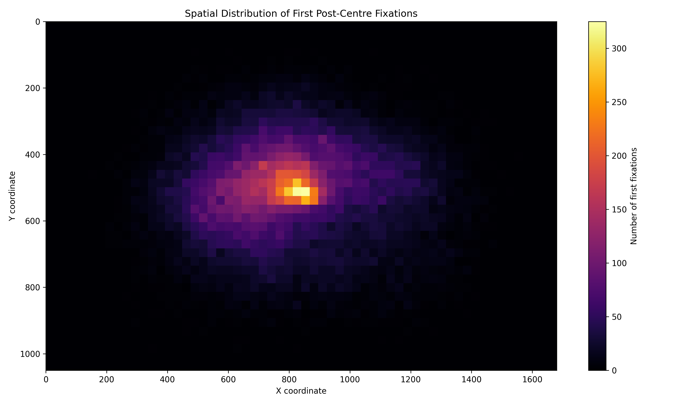
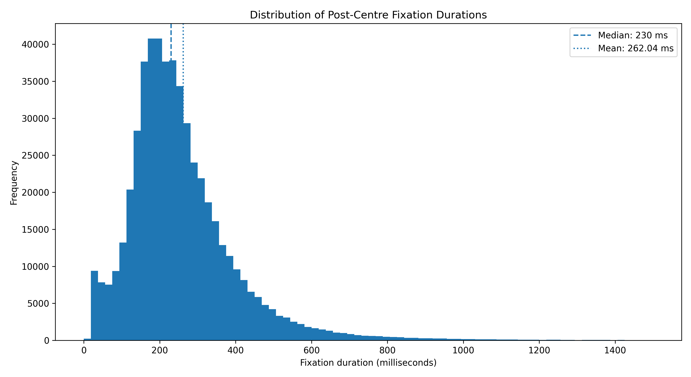
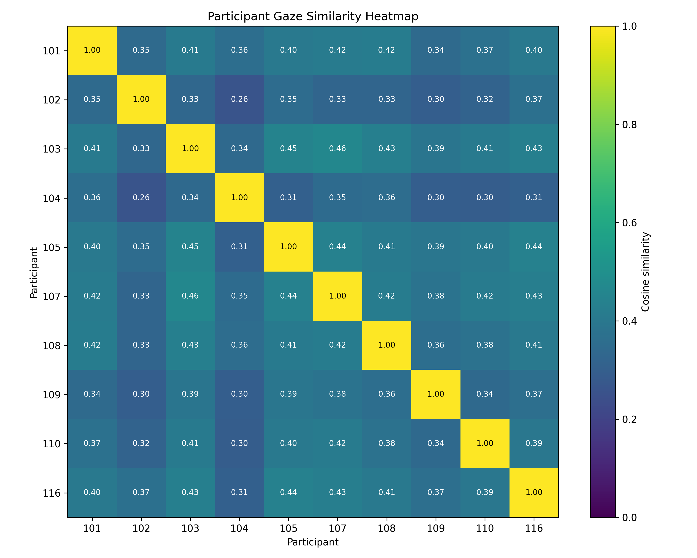
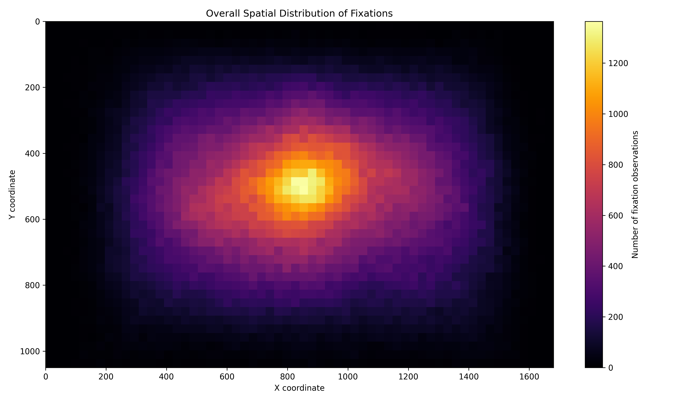
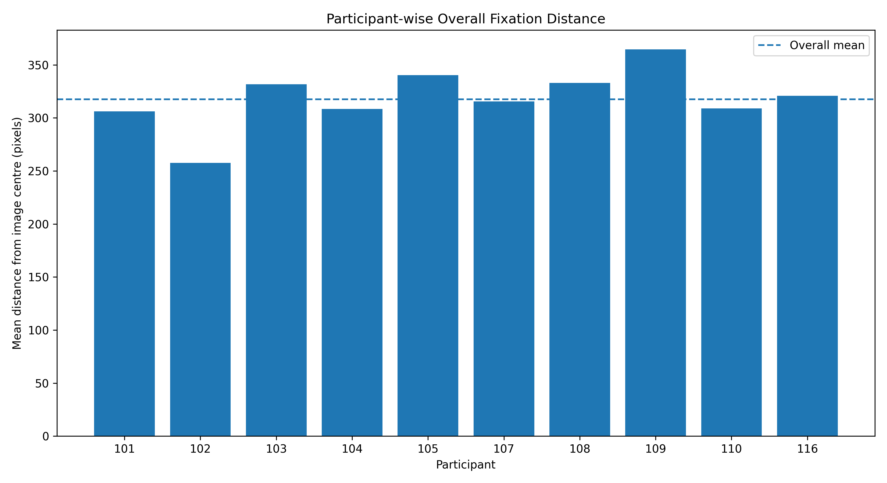
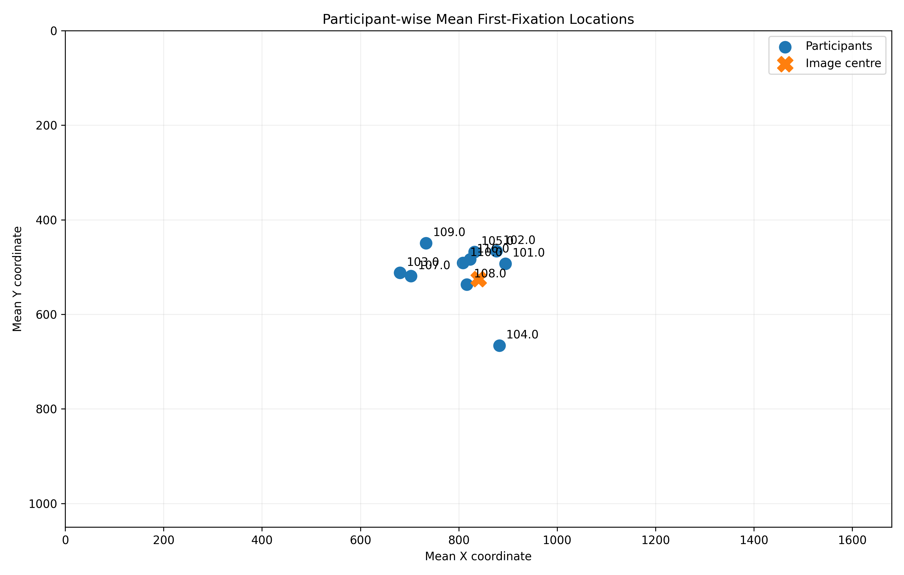

# Understanding Human Visual Attention Through Gaze Trajectories in Natural Images

## Overview
This research project explores how humans visually attend to natural images by analyzing eye-tracking data from the COCO-FreeView dataset.

The study examines first-fixation locations, spatial fixation distributions, and similarities in gaze patterns across participants.

## Research Objectives
- Analyze where viewers direct their first visual attention.
- Study the spatial distribution of fixation points.
- Compare gaze patterns across participants.
- Understand similarities and differences in human visual attention.

## Dataset
**COCO-FreeView**

The analysis uses eye-tracking observations collected from 10 participants viewing natural images.

## Project Statistics
- Total trials: 36,586
- Post-centre fixation observations: 528,476
- Participants: 10
- Images viewed by all participants: 3,524

## Methodology
1. Data loading and preprocessing
2. First-fixation analysis
3. Spatial fixation distribution analysis
4. Participant gaze-pattern similarity analysis
5. Visualization and result export

## Results

The project includes:
- 6 research figures
- 6 CSV result files

### Research Visualizations

### 1. First Fixation Heatmap

### 2. Fixation Duration Distribution

### 3. Gaze Similarity Heatmap

### 4. Overall Fixation Heatmap

### 5. Participant Fixation Distance

### 6. Participant Mean Locations

Detailed analysis and methodology are available in the Jupyter Notebook.

### Data Files

The `Results/` directory contains six CSV files with processed data and analysis outputs generated during the study.

These files support the analysis of:
- First-fixation patterns
- Fixation duration
- Gaze similarity between participants
- Spatial distribution of fixations
- Participant-level gaze behaviour

## Tools & Technologies
- Python
- Google Colab
- Jupyter Notebook
- Pandas
- NumPy
- Matplotlib
- Seaborn

## Repository Structure
- `COCO_FreeView_Research.ipynb` – Main research notebook
- `Figures/` – Research visualizations
- `Results/` – Exported analysis files

## Research Focus
Human visual attention, eye-tracking, gaze trajectories, fixation analysis, and behavioral data analysis.

---

*An independent research project exploring patterns of human visual attention in natural images.*
